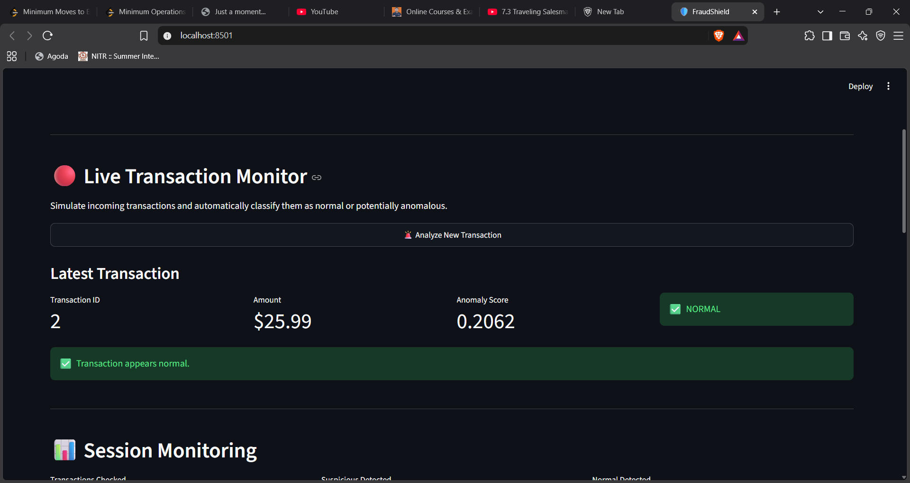
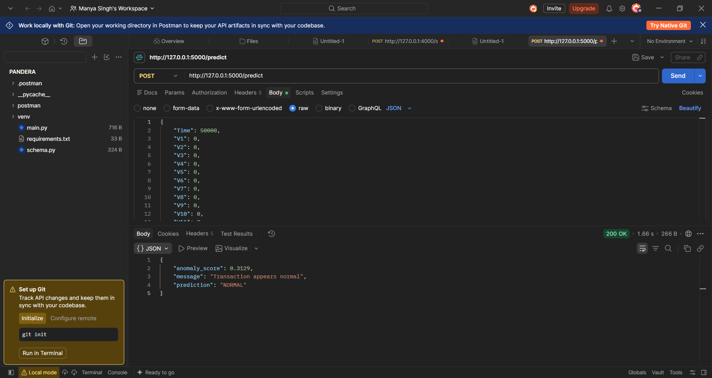

# FraudShield — Financial Transaction Anomaly Detection

An end-to-end unsupervised machine learning system that detects suspicious financial transactions in real time, served via a Flask REST API and an interactive Streamlit frontend.

## Problem Statement
Financial transaction datasets are heavily imbalanced, and labeled fraud data is often unavailable or delayed in real-world pipelines. FraudShield uses unsupervised anomaly detection to flag unusual transactions without relying on labeled fraud examples during training.

## System Architecture
```text
User Input (Streamlit - app.py)
        │  HTTP POST -> /predict (JSON payload)
        ▼
Flask REST API (api.py)
        │  Loads scaler.pkl & isolation_forest.pkl
        ▼
Prediction Response (anomaly_score, prediction, message)
```

## Dataset
* **Total Transactions:** 284,807 rows, 31 columns (`Time`, `V1`–`V28`, `Amount`, `Class`)
* **Class Distribution:** 284,315 normal transactions | 492 fraudulent transactions (~0.173% fraud)

## Model & Evaluation
* **Algorithm:** Isolation Forest (Unsupervised)
* **Preprocessing:** Feature scaling (`scaler.pkl`)
* **Evaluation Results (evaluated against ground-truth labels):**

| Metric | Score |
| :--- | :---: |
| **Precision** | 28.04% |
| **Recall** | 30.61% |
| **F1-Score** | 29.27% |

*(Note: Because Isolation Forest is trained purely unsupervised without fraud labels on an extreme 0.173% class imbalance, these metrics represent an unsupervised baseline.)*

## Tech Stack
* **ML & Data:** Python, Pandas, NumPy, Scikit-learn, Matplotlib, Seaborn
* **Backend & API Testing:** Flask, Postman
* **Frontend:** Streamlit

## Project Structure
```text
FraudShield_Hackathon/
├── assets/
│   ├── streamlit_interface.png  # Streamlit dashboard screenshot
│   └── postman_testing.png      # Postman /predict API test screenshot
├── models/
│   ├── isolation_forest.pkl     # Serialized Isolation Forest model
│   └── scaler.pkl               # Fitted feature scaler
├── notebooks/
│   └── analysis.ipynb           # EDA and model experimentation
├── train_model.py               # Script to train and export model artifacts
├── api.py                       # Flask REST API serving /predict endpoint
├── app.py                       # Streamlit UI calling the Flask API
├── requirements.txt             # Project dependencies
└── README.md
```

## How to Run Locally

1. **Clone the repository and install dependencies:**
   ```bash
   git clone [https://github.com/MAANYA358/FraudShield_Hackathon.git](https://github.com/MAANYA358/FraudShield_Hackathon.git)
   cd FraudShield_Hackathon
   pip install -r requirements.txt
   ```

2. **Start the Flask API:**
   ```bash
   python api.py
   ```
   The API will run at `http://127.0.0.1:5000` with the prediction endpoint at `POST /predict`.

3. **Run the Streamlit frontend (in a separate terminal):**
   ```bash
   streamlit run app.py
   ```

## Demo Screenshots

### Streamlit Live Transaction Monitor


### Postman API Testing (`POST /predict`)


